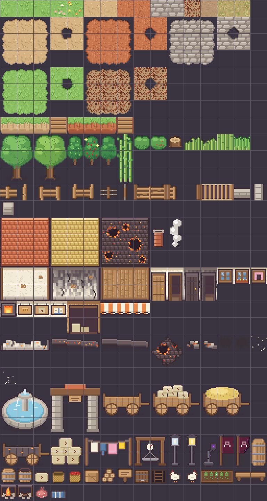
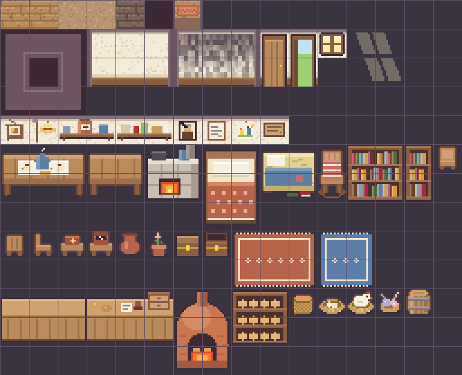
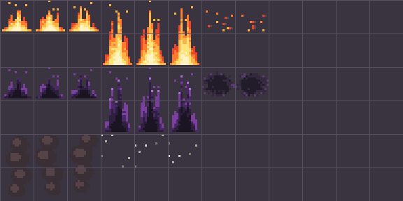
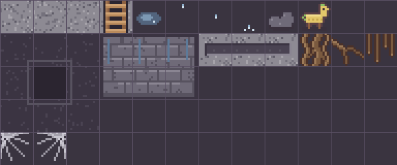
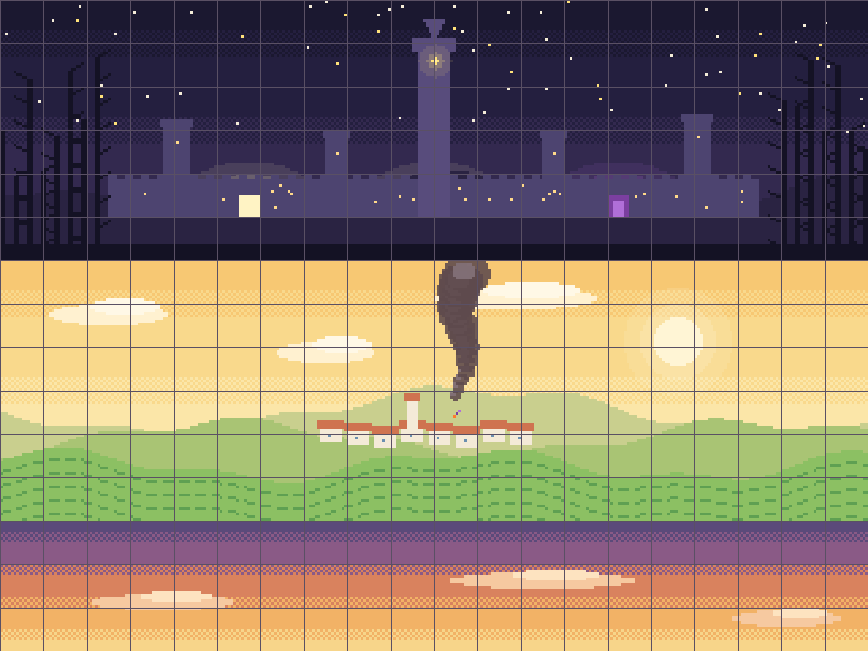

# Guia de tiles do prólogo

> Gerado por `python3 tools/arte/gerar_tilesets.py` (o texto de abertura vem de
> `tools/arte/TILESET_prefacio.md`). **Não edite este arquivo à mão.**

Para a sessão de mapas. Todos os tiles são 16×16, sem margem nem espaçamento.

## Como usar no Tiled

1. **Tilesets embutidos.** Cada tileset tem um JSON pronto em `docs/arte/tilesets/<nome>.json`, já com
   as propriedades `collides` e `hide` por tile. Copie o objeto para a lista `tilesets` do mapa e
   acrescente `"firstgid"` (1 para o primeiro; para os seguintes, `firstgid` anterior + `tilecount` anterior).
   O nome do tileset tem de ser igual ao do arquivo em `assets/tilesets/`.
2. **Índice → gid.** Os índices deste guia começam em 0. No mapa, `gid = firstgid + índice`.
   Para scripts, `docs/arte/tilesets/<nome>.indices.json` traz `nome → índice` (ou matriz de índices,
   linha por linha, para blocos maiores que 1×1).
3. **Blocos.** Um bloco "3×2" ocupa 3 colunas × 2 linhas contíguas no tileset; a coluna "Índices" mostra a
   matriz na mesma disposição em que deve ir para o mapa.
4. **Camadas sugeridas** (de baixo para cima):

   | Camada | Conteúdo |
   |---|---|
   | `chao` | Terreno opaco: grama, terra, pisos, panoramas. |
   | `chao2` | Transições (`borda_*`), tapetes, manchas, brasas, luz no chão: tiles com transparência. |
   | `objetos` | Paredes, móveis, cercas, troncos, a parte de baixo de objetos altos. Colisão vem do tile. |
   | `objetos2` | Opcional: o que fica por cima de outro objeto (chaminé no telhado, placa, toldo). |
   | `acima` | O que cobre o jogador: copas, topo de lampiões/bandeiras/carroças, fumaça, cinzas. O nome deve começar com `acima`. |

   Na coluna "Uso", "Camada `acima`: ■■ / ·· " indica quais tiles do bloco (■) vão na camada `acima`;
   o resto vai em `objetos`. A coluna "Sólido" mostra do mesmo jeito quais tiles colidem.
5. **Esconderijos.** Tiles marcados **`hide`** (arbustos) escondem o jogador que pisa neles. Carroças, barris,
   sacas e muretas são sólidos: desenhe um objeto `esconderijo` (retângulo) no chão ao lado/atrás deles.

## Dia, tarde e noite: a mesma planta

`tiles_exterior` tem três imagens com **exatamente os mesmos índices**: `tiles_exterior` (manhã),
`tiles_exterior_tarde` (luz dourada do cafezal e da estrada) e `tiles_exterior_noite` (vila em chamas e
bambuzal). O mesmo vale para `tiles_interior` / `tiles_interior_noite`.

Para fazer `prologo_vila` a partir de `prologo_vila_manha`: copie o mapa, troque o nome/imagem do tileset
para a variação `_noite` e depois troque só os tiles que mudam (telhado → `telhado_queimado`, parede →
`parede_queimada`, janela → `janela_fogo`, lampião → `lampiao_derretido`, carroça → `carroca_queimada`…),
some o fogo de `tiles_fogo` e as bandeiras. As cores de fogo, brasa e luz **não escurecem** na variação
de noite, então elas "acendem" a cena. A casa de Ícaro em ruína usa o piso e os móveis de
`tiles_interior_noite` cercados por `ruina_parede`, com a `viga_caida` no meio.

Mapa → tilesets:

| Mapa | Tilesets |
|---|---|
| `prologo_casa_icaro`, `prologo_casa_custodia`, `prologo_padaria`, `prologo_biblioteca` | `tiles_interior` (+ `tiles_exterior` no terreiro da casa de Ícaro) |
| `prologo_vila_manha` | `tiles_exterior` |
| `prologo_cafezal` | `tiles_exterior_tarde`, `tiles_panorama` |
| `prologo_estrada` | `tiles_exterior_tarde`, `tiles_panorama` (céu) |
| `prologo_vila` | `tiles_exterior_noite`, `tiles_interior_noite`, `tiles_fogo` |
| `prologo_tunel` | `tiles_tunel` |
| `prologo_bambuzal` | `tiles_exterior_noite`, `tiles_panorama` |

## Receitas

**Casa (5 de largura):** veja `docs/arte/capturas/mock_vila_dia.png`.

```
T T T T T     T = telhado (bloco 3×3: repita a coluna do meio)
T T T T T
T T T T T
P J D S P     P = parede linha de cima (L, M…, R); J = janela; S = placa; D = porta (tile de cima)
P P D P P     P = parede linha de baixo; D = porta (tile de baixo)
```

**Sala interna:** `moldura` em volta, duas linhas de `parede_fundo`, piso, e uma `soleira` na moldura de baixo
(veja `docs/arte/capturas/mock_casa_icaro.png`).

**Caminho/praça:** pinte o chão base em `chao` e a mancha com o bloco `borda_*` em `chao2`
(cantos nos cantos, lados nos lados, centro no miolo; `borda_*_int` nas curvas para dentro).

Exemplos montados só com estes tiles: `docs/arte/capturas/mock_*.png`.

## Estabilidade dos índices

Os índices não mudam: tiles novos entram sempre **no fim** de cada tileset. Se faltar algum tile, peça em
`docs/status/arte.md`.


---

## `tiles_exterior`

- Arquivo: `assets/tilesets/tiles_exterior.png` — 256×480 px, **16 colunas**, 480 tiles.
- Variações de luz com os **mesmos índices**: `tiles_exterior_tarde`, `tiles_exterior_noite`.
- Tileset pronto para embutir: `docs/arte/tilesets/tiles_exterior.json` · nomes → índices: `docs/arte/tilesets/tiles_exterior.indices.json`.
- Prancha ampliada: 

### Chão (camada `chao`, opacos)

Variações do mesmo terreno podem ser misturadas à vontade.

| Nome | Índices | Tam. | Sólido | Uso |
|---|---|---|---|---|
| `grama_1` | **0** | 1×1 | — | Grama (3 variações). |
| `grama_2` | **1** | 1×1 | — | Grama (3 variações). |
| `grama_3` | **2** | 1×1 | — | Grama (3 variações). |
| `grama_flores_1` | **3** | 1×1 | — | Grama com flores brancas e rosa. |
| `grama_flores_2` | **4** | 1×1 | — | Grama com flores amarelas e laranja. |
| `terra_1` | **5** | 1×1 | — | Terra clara: ruas da vila, estrada. |
| `terra_2` | **6** | 1×1 | — | Terra clara (variação). |
| `terra_vermelha_1` | **7** | 1×1 | — | Terra vermelha do cafezal. |
| `terra_vermelha_2` | **8** | 1×1 | — | Terra vermelha (variação). |
| `calcamento_1` | **9** | 1×1 | — | Calçamento de pedra: praça do chafariz. |
| `calcamento_2` | **10** | 1×1 | — | Calçamento (variação). |
| `terreiro_1` | **11** | 1×1 | — | Terreiro de secar café (grãos espalhados). |
| `terreiro_2` | **12** | 1×1 | — | Terra batida do terreiro, sem grãos. |
| `folhas_1` | **13** | 1×1 | — | Chão de folhas secas do bambuzal. |
| `folhas_2` | **14** | 1×1 | — | Chão de folhas (variação). |

### Transições de terreno (camada `chao2`)

Blocos 3×3: cantos, lados e centro de uma mancha do terreno, com o lado de fora transparente — pinte por cima de qualquer chão (camada `chao2`). Bloco 2×2 `_int`: cantos internos (para curvas em L); cada tile é o terreno inteiro com um cantinho transparente voltado para o centro do bloco.

| Nome | Índices | Tam. | Sólido | Uso |
|---|---|---|---|---|
| `borda_terra` | 16 17 18<br>32 33 34<br>48 49 50 | 3×3 | — | Mancha de terra com borda irregular. |
| `borda_terra_int` | 19 20<br>35 36 | 2×2 | — | Cantos internos de terra. |
| `borda_terra_vermelha` | 21 22 23<br>37 38 39<br>53 54 55 | 3×3 | — | Mancha de terra vermelha com borda irregular. |
| `borda_terra_vermelha_int` | 24 25<br>40 41 | 2×2 | — | Cantos internos de terra vermelha. |
| `borda_calcamento` | 26 27 28<br>42 43 44<br>58 59 60 | 3×3 | — | Mancha de calcamento com borda irregular. |
| `borda_calcamento_int` | 29 30<br>45 46 | 2×2 | — | Cantos internos de calcamento. |
| `borda_grama` | 64 65 66<br>80 81 82<br>96 97 98 | 3×3 | — | Mancha de grama com borda irregular. |
| `borda_grama_int` | 67 68<br>83 84 | 2×2 | — | Cantos internos de grama. |
| `borda_terreiro` | 69 70 71<br>85 86 87<br>101 102 103 | 3×3 | — | Mancha de terreiro com borda irregular. |
| `borda_terreiro_int` | 72 73<br>88 89 | 2×2 | — | Cantos internos de terreiro. |

### Relevo: morro em degraus

Use uma fileira de `barranco` entre dois níveis de grama; a escada é o único ponto de passagem.

| Nome | Índices | Tam. | Sólido | Uso |
|---|---|---|---|---|
| `barranco_L` | **112** | 1×1 | sim | Ponta esquerda do degrau. |
| `barranco_M` | **113** | 1×1 | sim | Meio do degrau (repete). |
| `barranco_R` | **114** | 1×1 | sim | Ponta direita do degrau. |
| `barranco_escada` | **115** | 1×1 | — | Escada de tábuas no degrau (passável). |
| `barranco_vermelho_L` | **116** | 1×1 | sim | Ponta esquerda do degrau. |
| `barranco_vermelho_M` | **117** | 1×1 | sim | Meio do degrau (repete). |
| `barranco_vermelho_R` | **118** | 1×1 | sim | Ponta direita do degrau. |
| `barranco_vermelho_escada` | **119** | 1×1 | — | Escada de tábuas no degrau (passável). |

### Vegetação

| Nome | Índices | Tam. | Sólido | Uso |
|---|---|---|---|---|
| `arvore_1` | 128 129<br>144 145<br>160 161 | 2×3 | ··<br>··<br>■■ | Árvore. A copa (2 linhas de cima) vai na camada `acima`; o tronco é sólido. Camada `acima`: ■■ / ■■ / ··. |
| `arvore_2` | 130 131<br>146 147<br>162 163 | 2×3 | ··<br>··<br>■■ | Árvore (verde mais claro). Camada `acima`: ■■ / ■■ / ··. |
| `pe_cafe_verde` | 132<br>148 | 1×2 | ·<br>■ | Pé de café verde (`pe_cafe_verde_N`). Camada `acima`: ■ / ·. |
| `pe_cafe_maduro` | 133<br>149 | 1×2 | ·<br>■ | Pé de café maduro, com brilho (`pe_cafe_maduro_N`). Camada `acima`: ■ / ·. |
| `pe_cafe_colhido` | 134<br>150 | 1×2 | ·<br>■ | Pé de café já colhido (fileiras de fundo). Camada `acima`: ■ / ·. |
| `bambu` | 135<br>151<br>167 | 1×3 | ·<br>·<br>■ | Touceira de bambu. Camada `acima`: ■ / ■ / ·. |
| `arbusto` | **136** | 1×1 | — | Arbusto baixo. **Esconderijo (`hide`).** |
| `arbusto_frutas` | **137** | 1×1 | — | Arbusto com frutinhas. **Esconderijo (`hide`).** |
| `toco` | **138** | 1×1 | sim | Toco de árvore (toco de leitura do Ícaro). |
| `capim_1` | **139** | 1×1 | — | Capim alto (enfeite, passável). |
| `capim_2` | **140** | 1×1 | — | Capim alto (variação). |
| `bambu_denso` | **141** | 1×1 | sim | Parede de bambu fechada: bordas do bambuzal. |
| `bambu_denso_topo` | **142** | 1×1 | sim | Topo folhudo da parede de bambu (linha de cima). |

### Cercas, porteira e mureta

| Nome | Índices | Tam. | Sólido | Uso |
|---|---|---|---|---|
| `cerca_h` | **176** | 1×1 | sim | Cerca de madeira horizontal. |
| `cerca_v` | **177** | 1×1 | sim | Cerca de madeira vertical. |
| `cerca_canto_no` | **178** | 1×1 | sim | Canto de cerca (NO). |
| `cerca_canto_ne` | **179** | 1×1 | sim | Canto de cerca (NE). |
| `cerca_canto_so` | **180** | 1×1 | sim | Canto de cerca (SO). |
| `cerca_canto_se` | **181** | 1×1 | sim | Canto de cerca (SE). |
| `arame_h` | **182** | 1×1 | sim | Cerca de arame horizontal (estrada). |
| `arame_v` | **183** | 1×1 | sim | Cerca de arame vertical. |
| `porteira` | 184 185 | 2×1 | sim | Porteira fechada. |
| `porteira_aberta` | 186 187 | 2×1 | ■· | Porteira aberta (passa pelo meio). |
| `mata_burro` | 188 189 | 2×1 | — | Mata-burro (chão; passável). |
| `mureta_h` | **190** | 1×1 | sim | Mureta de pedra horizontal. |
| `mureta_v` | **191** | 1×1 | sim | Mureta de pedra vertical. |
| `mureta_pilar` | **192** | 1×1 | sim | Pilar de mureta (cantos e pontas). |

### Casas: telhado (modular)

Bloco 3×3 = cantos/lados/meio; repita a coluna e a linha do meio para casas maiores. Receita de casa: N linhas de telhado, depois 2 linhas de parede (`parede` linha de cima + linha de baixo). Tudo sólido. Para o jogador passar "por trás" do telhado, ponha a 1ª linha do telhado numa camada `acima`.

| Nome | Índices | Tam. | Sólido | Uso |
|---|---|---|---|---|
| `telhado` | 208 209 210<br>224 225 226<br>240 241 242 | 3×3 | sim | Telhado de telha de barro. |
| `telhado_palha` | 211 212 213<br>227 228 229<br>243 244 245 | 3×3 | sim | Telhado de palha/sapé (barracão, casas simples). |
| `telhado_queimado` | 214 215 216<br>230 231 232<br>246 247 248 | 3×3 | sim | Telhado queimando: carvão, buracos e brasas (vila à noite). |
| `chamine` | 217<br>233 | 1×2 | ·<br>■ | Chaminé de tijolo; coloque sobre o telhado (camada de objetos acima da do telhado). |
| `fumaca_chamine` | 218<br>234 | 1×2 | — | Fumaça branca de chaminé (manhã): acima da chaminé, camada `acima`. Vai na camada `acima`. |

### Casas: paredes, portas, janelas e placas

Bloco 3×2 de parede: linha de cima (sob o beiral) e de baixo (rodapé de pedra); colunas esquerda/meio/direita. Janelas e placas substituem um tile do MEIO da linha de cima. Portas (1×2) substituem uma coluna inteira do meio.

| Nome | Índices | Tam. | Sólido | Uso |
|---|---|---|---|---|
| `parede` | 256 257 258<br>272 273 274 | 3×2 | sim | Parede caiada de pau a pique. |
| `parede_queimada` | 259 260 261<br>275 276 277 | 3×2 | sim | Parede com fuligem e rachaduras. |
| `parede_madeira` | 262 263 264<br>278 279 280 | 3×2 | sim | Parede de tábuas (barracão, galpões). |
| `porta` | 265<br>281 | 1×2 | sim | Porta fechada. Sólida; a `saida` fica no tile em frente. |
| `porta_aberta` | 266<br>282 | 1×2 | ■<br>· | Porta aberta (manhã: casas visitáveis). Ponha a `saida` sobre o tile de baixo. |
| `porta_queimada` | 267<br>283 | 1×2 | sim | Porta chamuscada (noite). |
| `porta_queimada_aberta` | 268<br>284 | 1×2 | ■<br>· | Porta arrombada (noite). |
| `janela` | **269** | 1×1 | sim | Janela de vidro. |
| `janela_flores` | **270** | 1×1 | sim | Janela com floreira. |
| `janela_aberta` | **271** | 1×1 | sim | Janela aberta com cortina. |
| `janela_fogo` | **288** | 1×1 | sim | Janela com fogo dentro (noite). |
| `placa_padaria` | **289** | 1×1 | sim | Placa da padaria (pão). |
| `placa_venda` | **290** | 1×1 | sim | Placa da venda (saca). |
| `placa_biblioteca` | **291** | 1×1 | sim | Placa da biblioteca (livro). |
| `portao_barracao` | 292 293<br>308 309 | 2×2 | sim | Portão aberto do barracão da Zefa (2×2, sobre `parede_madeira`). |
| `toldo` | 294 295 296 | 3×1 | — | Toldo listrado (padaria/venda): sobre a linha de cima da parede, camada `acima` ou objetos. |

### Ruínas e marcas de fogo (vila à noite)

O fogo animado está em `tiles_fogo`. `chao_queimado` e `cinzas` são transparentes: camada `chao2`.

| Nome | Índices | Tam. | Sólido | Uso |
|---|---|---|---|---|
| `ruina_parede` | 320 321 322 | 3×1 | sim | Resto de parede baixa (L, M, R). Casa de Ícaro em ruína: contorne o piso com estes. |
| `viga_caida` | 323 324 325 | 3×1 | sim | Viga caída em brasa (a viga do pai: `marcador_casa_viga`). |
| `viga_caida_fria` | 326 327 328 | 3×1 | sim | Viga caída sem brasa. |
| `telhado_caido` | 329 330<br>345 346 | 2×2 | sim | Pedaço de telhado desabado. |
| `entulho_1` | **331** | 1×1 | sim | Entulho. |
| `entulho_2` | **332** | 1×1 | sim | Entulho (variação). |
| `chao_queimado_1` | **333** | 1×1 | — | Mancha de chão queimado. |
| `chao_queimado_2` | **334** | 1×1 | — | Mancha de chão queimado (variação). |
| `cinzas_1` | **335** | 1×1 | — | Cinzas espalhadas. |
| `cinzas_2` | **352** | 1×1 | — | Cinzas (variação). |

### Objetos da vila

Objetos sólidos servem de esconderijo com um objeto `esconderijo` (retângulo) ao lado/atrás; os marcados `hide` escondem quem pisa neles.

| Nome | Índices | Tam. | Sólido | Uso |
|---|---|---|---|---|
| `chafariz` | 368 369 370<br>384 385 386<br>400 401 402 | 3×3 | sim | Chafariz de pedra da praça. |
| `portao_vila` | 371 372 373<br>387 388 389<br>403 404 405 | 3×3 | ···<br>■·■<br>■·■ | Portão da vila: passa-se pelo meio. Camada `acima`: ■■■ / ··· / ···. |
| `carroca` | 374 375 376<br>390 391 392 | 3×2 | ···<br>■■■ | Carroça vazia. Camada `acima`: ■■■ / ···. |
| `carroca_sacas` | 377 378 379<br>393 394 395 | 3×2 | ···<br>■■■ | Carroça carregada de sacas (manhã). Camada `acima`: ■■■ / ···. |
| `carroca_feno` | 380 381 382<br>396 397 398 | 3×2 | ···<br>■■■ | Carroça com feno. Camada `acima`: ■■■ / ···. |
| `carroca_queimada` | 416 417 418<br>432 433 434 | 3×2 | ···<br>■■■ | Carroça chamuscada (noite; esconderijo 1). Camada `acima`: ■■■ / ···. |
| `sacas` | 419 420<br>435 436 | 2×2 | ··<br>■■ | Pilha de sacas de café. Camada `acima`: ■■ / ··. |
| `varal` | 421 422 423<br>437 438 439 | 3×2 | ■·■<br>■·■ | Varal com roupa (manhã). |
| `balanca` | 424 425<br>440 441 | 2×2 | ··<br>■■ | Balança de pesagem da Zefa. Camada `acima`: ■■ / ··. |
| `lampiao` | 426<br>442 | 1×2 | ·<br>■ | Lampião de ferro apagado (dia). Camada `acima`: ■ / ·. |
| `lampiao_aceso` | 427<br>443 | 1×2 | ·<br>■ | Lampião aceso (entardecer/noite). Camada `acima`: ■ / ·. |
| `lampiao_derretido` | 428<br>444 | 1×2 | ·<br>■ | Lampião derretido pelo fogo negro. Camada `acima`: ■ / ·. |
| `bandeira_cali` | 429<br>445 | 1×2 | ·<br>■ | Bandeira Caligosuin fincada. Camada `acima`: ■ / ·. |
| `bandeira_cali_chamuscada` | 430<br>446 | 1×2 | ·<br>■ | Bandeira Caligosuin chamuscada. Camada `acima`: ■ / ·. |
| `barril_grande` | 431<br>447 | 1×2 | ·<br>■ | Barril grande de melado (o `barril_custodia` fechado). Camada `acima`: ■ / ·. |
| `barril` | **448** | 1×1 | sim | Barril. |
| `barril_aberto` | **449** | 1×1 | sim | Barril sem tampa. |
| `saca` | **450** | 1×1 | sim | Saca de café solta. |
| `cesto` | **451** | 1×1 | sim | Cesto de colheita vazio. |
| `cesto_cheio` | **452** | 1×1 | sim | Cesto cheio de café (`cesto_icaro`). |
| `caixote` | **453** | 1×1 | sim | Caixote. |
| `lenha` | **454** | 1×1 | sim | Pilha de lenha. |
| `placa_poste` | **455** | 1×1 | sim | Placa de madeira em poste. |
| `alcapao` | **456** | 1×1 | — | Alçapão da adega fechado (`marcador_terreiro_alcapao`). |
| `alcapao_aberto` | **457** | 1×1 | — | Alçapão aberto. |
| `galinha_1` | **458** | 1×1 | — | Galinha ciscando (enfeite; há também o sprite `galinha`). |
| `galinha_2` | **459** | 1×1 | — | Galinha virada para o outro lado. |
| `canteiro` | 460 461 | 2×1 | sim | Canteiro de horta. |
| `banco` | 462 463 | 2×1 | sim | Banco de madeira. |

### Acampamento do bambuzal

| Nome | Índices | Tam. | Sólido | Uso |
|---|---|---|---|---|
| `fogueira_coberta` | **464** | 1×1 | sim | Fogueira coberta com pano (acesa). |
| `fogueira_apagada` | **465** | 1×1 | sim | Fogueira coberta apagada. |
| `trouxa` | **466** | 1×1 | sim | Trouxa de roupa. |
| `cobertor` | **467** | 1×1 | — | Cobertor enrolado. |

---

## `tiles_interior`

- Arquivo: `assets/tilesets/tiles_interior.png` — 256×208 px, **16 colunas**, 208 tiles.
- Variações de luz com os **mesmos índices**: `tiles_interior_noite`.
- Tileset pronto para embutir: `docs/arte/tilesets/tiles_interior.json` · nomes → índices: `docs/arte/tilesets/tiles_interior.indices.json`.
- Prancha ampliada: 

### Pisos (camada `chao`)

| Nome | Índices | Tam. | Sólido | Uso |
|---|---|---|---|---|
| `tabua_1` | **0** | 1×1 | — | Chão de tábua. |
| `tabua_2` | **1** | 1×1 | — | Chão de tábua (variação). |
| `terra_batida_1` | **2** | 1×1 | — | Chão de terra batida (cozinha, casas simples). |
| `terra_batida_2` | **3** | 1×1 | — | Terra batida (variação). |
| `tabua_queimada` | **4** | 1×1 | — | Tábua chamuscada (casa em ruína). |
| `vazio` | **5** | 1×1 | sim | Escuro de fora da sala: preencha o resto do mapa. |
| `soleira` | **6** | 1×1 | — | Vão da porta da frente, na linha de baixo da moldura (ponha a `saida` aqui). |

### Paredes

Receita de sala: linha 0 = `moldura` de cima; linhas 1–2 = `parede_fundo`; depois o piso com a `moldura` esquerda/direita nas laterais; última linha = `moldura` de baixo com uma `soleira` na porta. O tile central da moldura é o mesmo que `vazio`.

| Nome | Índices | Tam. | Sólido | Uso |
|---|---|---|---|---|
| `moldura` | 16 17 18<br>32 33 34<br>48 49 50 | 3×3 | sim | Topo das paredes visto de cima (3×3: cantos e lados). |
| `parede_fundo` | 19 20 21<br>35 36 37 | 3×2 | sim | Parede caiada do fundo (3×2: L, M, R × cima, baixo). |
| `parede_fundo_queimada` | 22 23 24<br>38 39 40 | 3×2 | sim | Parede do fundo com fuligem (ruína). |
| `porta_fundos` | 25<br>41 | 1×2 | sim | Porta dos fundos fechada (substitui uma coluna da parede do fundo). |
| `porta_fundos_aberta` | 26<br>42 | 1×2 | ■<br>· | Porta dos fundos aberta para o terreiro. |
| `janela_luz` | **27** | 1×1 | sim | Janela com luz da manhã (tile do meio, linha de cima). |
| `luz_chao` | 28 29<br>44 45 | 2×2 | — | Mancha de sol no chão, abaixo da janela (camada `chao2`, translúcida). |

### Coisas de parede (substituem um tile do meio da linha de cima)

| Nome | Índices | Tam. | Sólido | Uso |
|---|---|---|---|---|
| `retrato_torto` | **64** | 1×1 | sim | Retrato torto da família (`exame_casa_retrato`). |
| `ferramentas` | **65** | 1×1 | sim | Enxada e chapéu de palha pendurados (`exame_casa_ferramentas`). |
| `prateleira_pote` | 66 67 | 2×1 | sim | Prateleira alta com o pote de barro "TELHADO" (`exame_casa_pote`). |
| `prateleira` | 68 69 | 2×1 | sim | Prateleira com mantimentos. |
| `retrato_fita` | **70** | 1×1 | sim | Retrato do finado Zé com fita preta (casa da Custódia). |
| `receita` | **71** | 1×1 | sim | Receita emoldurada (padaria). |
| `desenho` | **72** | 1×1 | sim | Desenho da Nina pregado na parede (padaria). |
| `placa_silencio` | **73** | 1×1 | sim | Placa "Silêncio. E limpe os pés." (biblioteca). |

### Móveis da casa

| Nome | Índices | Tam. | Sólido | Uso |
|---|---|---|---|---|
| `mesa_posta` | 80 81 82<br>96 97 98 | 3×2 | sim | Mesa posta com bule, canecas e pão (café com o pai). |
| `mesa` | 83 84<br>99 100 | 2×2 | sim | Mesa vazia. |
| `fogao` | 85 86<br>101 102 | 2×2 | sim | Fogão a lenha aceso com panela e bule (`exame_casa_fogao`). |
| `catre` | 87 88<br>103 104<br>119 120 | 2×3 | sim | Catre com colcha (cama do pai). |
| `colchao_palha` | 89 90<br>105 106 | 2×2 | sim | Colchão de palha do Ícaro, com livros escondidos embaixo (`exame_casa_colchao`). |
| `cadeira_balanco` | 91<br>107 | 1×2 | sim | Cadeira de balanço com manta (`exame_casa_cadeira`). |
| `estante` | 92 93<br>108 109 | 2×2 | sim | Estante de livros larga (biblioteca). |
| `estante_estreita` | 94<br>110 | 1×2 | sim | Estante estreita. |
| `cadeira_frente` | **95** | 1×1 | sim | Cadeira (de frente). |
| `cadeira_costas` | **128** | 1×1 | sim | Cadeira (de costas). |
| `cadeira_lado` | **129** | 1×1 | sim | Cadeira (de lado; espelhe no Tiled para o outro lado). |
| `caixa_costura` | **130** | 1×1 | sim | Mesinha com a caixinha de costura fechada (`exame_casa_caixa_costura`). |
| `caixa_costura_aberta` | **131** | 1×1 | sim | Caixinha de costura aberta. |
| `pote_barro` | **132** | 1×1 | sim | Pote de barro. |
| `vaso_flor` | **133** | 1×1 | sim | Vaso com flor. |
| `bau` | **134** | 1×1 | sim | Baú fechado. |
| `bau_aberto` | **135** | 1×1 | sim | Baú aberto. |
| `tapete` | 136 137 138<br>152 153 154 | 3×2 | — | Tapete (camada `chao2`). |
| `tapete_azul` | 139 140<br>155 156 | 2×2 | — | Tapete azul 2×2 (camada `chao2`). |

### Padaria, biblioteca e casa da Custódia

| Nome | Índices | Tam. | Sólido | Uso |
|---|---|---|---|---|
| `balcao_L` | 160<br>176 | 1×2 | sim | Balcão: ponta esquerda. |
| `balcao_M` | 161<br>177 | 1×2 | sim | Balcão: meio (repete). |
| `balcao_R` | 162<br>178 | 1×2 | sim | Balcão: ponta direita. |
| `balcao_paes` | 163<br>179 | 1×2 | sim | Balcão com pães (padaria). |
| `balcao_carimbo` | 164<br>180 | 1×2 | sim | Balcão com ficha e carimbo (Ermelinda). |
| `balcao_fichario` | 165<br>181 | 1×2 | sim | Balcão com o fichário de empréstimos (`exame_biblioteca_ficha`). |
| `forno` | 166 167<br>182 183<br>198 199 | 2×3 | sim | Forno de barro aceso (`exame_juca_forno`). |
| `prateleira_paes` | 168 169<br>184 185 | 2×2 | sim | Prateleira de pães. |
| `cesto_paes` | **170** | 1×1 | sim | Cesto de pães. |
| `ninho` | **171** | 1×1 | sim | Ninho da Pamonha com ovos. |
| `ninho_galinha` | **172** | 1×1 | sim | Ninho com a galinha chocando. |
| `croche` | **173** | 1×1 | sim | Cesta de crochê (`exame_custodia_croche`). |
| `barril_melado` | **174** | 1×1 | sim | Barril de melado (`exame_custodia_barril`). |

---

## `tiles_fogo`

- Arquivo: `assets/tilesets/tiles_fogo.png` — 192×96 px, **12 colunas**, 72 tiles.
- Tileset pronto para embutir: `docs/arte/tilesets/tiles_fogo.json` · nomes → índices: `docs/arte/tilesets/tiles_fogo.indices.json`.
- Prancha ampliada: 

### Fogo comum (alaranjado)

O motor ainda não anima tiles: use o quadro 1 como imagem parada (ou alterne quadros entre tiles vizinhos para dar variedade). Os mesmos quadros existem como spritesheets em `assets/sprites/fx_*.png` (ver docs/status/arte.md). Estas cores não escurecem: o fogo "acende" a cena da noite. Tudo passável, exceto onde indicado; para bloquear o caminho com fogo, use a versão alta na camada de objetos.

| Nome | Índices | Tam. | Sólido | Uso |
|---|---|---|---|---|
| `fogo_1` | **0** | 1×1 | sim | Fogo baixo, quadro 1. |
| `fogo_2` | **1** | 1×1 | sim | Fogo baixo, quadro 2. |
| `fogo_3` | **2** | 1×1 | sim | Fogo baixo, quadro 3. |
| `fogo_alto_1` | 3<br>15 | 1×2 | ·<br>■ | Labareda alta (1×2), quadro 1. Camada `acima`: ■ / ·. |
| `fogo_alto_2` | 4<br>16 | 1×2 | ·<br>■ | Labareda alta (1×2), quadro 2. Camada `acima`: ■ / ·. |
| `fogo_alto_3` | 5<br>17 | 1×2 | ·<br>■ | Labareda alta (1×2), quadro 3. Camada `acima`: ■ / ·. |
| `brasas_1` | **6** | 1×1 | — | Brasas no chão (camada `chao2`). |
| `brasas_2` | **7** | 1×1 | — | Brasas (variação). |

### Fogo negro Caligosuin (preto com borda roxa)

| Nome | Índices | Tam. | Sólido | Uso |
|---|---|---|---|---|
| `fogo_negro_1` | **24** | 1×1 | sim | Fogo negro baixo, quadro 1. |
| `fogo_negro_2` | **25** | 1×1 | sim | Fogo negro baixo, quadro 2. |
| `fogo_negro_3` | **26** | 1×1 | sim | Fogo negro baixo, quadro 3. |
| `fogo_negro_alto_1` | 27<br>39 | 1×2 | ·<br>■ | Labareda negra alta (1×2), quadro 1. Camada `acima`: ■ / ·. |
| `fogo_negro_alto_2` | 28<br>40 | 1×2 | ·<br>■ | Labareda negra alta (1×2), quadro 2. Camada `acima`: ■ / ·. |
| `fogo_negro_alto_3` | 29<br>41 | 1×2 | ·<br>■ | Labareda negra alta (1×2), quadro 3. Camada `acima`: ■ / ·. |
| `mancha_negra_1` | **30** | 1×1 | — | Fuligem do fogo negro no chão/parede (camada `chao2`). |
| `mancha_negra_2` | **31** | 1×1 | — | Fuligem (variação). |

### Fumaça e cinzas (camada `acima`)

| Nome | Índices | Tam. | Sólido | Uso |
|---|---|---|---|---|
| `fumaca_preta_1` | 48<br>60 | 1×2 | — | Coluna de fumaça preta (1×2), quadro 1. Vai na camada `acima`. |
| `fumaca_preta_2` | 49<br>61 | 1×2 | — | Coluna de fumaça preta (1×2), quadro 2. Vai na camada `acima`. |
| `fumaca_preta_3` | 50<br>62 | 1×2 | — | Coluna de fumaça preta (1×2), quadro 3. Vai na camada `acima`. |
| `cinzas_caindo_1` | **51** | 1×1 | — | Cinzas caindo, quadro 1: espalhe pela camada `acima`. Vai na camada `acima`. |
| `cinzas_caindo_2` | **52** | 1×1 | — | Cinzas caindo, quadro 2: espalhe pela camada `acima`. Vai na camada `acima`. |
| `cinzas_caindo_3` | **53** | 1×1 | — | Cinzas caindo, quadro 3: espalhe pela camada `acima`. Vai na camada `acima`. |

---

## `tiles_tunel`

- Arquivo: `assets/tilesets/tiles_tunel.png` — 192×80 px, **12 colunas**, 60 tiles.
- Tileset pronto para embutir: `docs/arte/tilesets/tiles_tunel.json` · nomes → índices: `docs/arte/tilesets/tiles_tunel.indices.json`.
- Prancha ampliada: 

### Túnel de pedra e raízes

O mapa do túnel usa `escuro: true`; o motor desenha a máscara com o círculo de luz. Receita: `rocha_topo` em volta (como a `moldura` dos interiores), `rocha_face` nas 2 linhas do fundo, piso de `pedra`.

| Nome | Índices | Tam. | Sólido | Uso |
|---|---|---|---|---|
| `pedra_1` | **0** | 1×1 | — | Chão de pedra úmida. |
| `pedra_2` | **1** | 1×1 | — | Chão de pedra úmida. |
| `pedra_3` | **2** | 1×1 | — | Chão de pedra úmida. |
| `escada_saida` | **3** | 1×1 | — | Escada de mão subindo (entrada pelo alçapão / saída para o bambuzal). |
| `poca` | **4** | 1×1 | — | Poça d'água (camada `chao2`). |
| `goteira_1` | **5** | 1×1 | — | Goteira, quadro 1 (use um só, parado, ou os três em tiles vizinhos). |
| `goteira_2` | **6** | 1×1 | — | Goteira, quadro 2 (use um só, parado, ou os três em tiles vizinhos). |
| `goteira_3` | **7** | 1×1 | — | Goteira, quadro 3 (use um só, parado, ou os três em tiles vizinhos). |
| `pedras_soltas` | **8** | 1×1 | sim | Pedras soltas. |
| `cavalinho_sabugo` | **9** | 1×1 | — | Cavalinho de sabugo de milho (`exame_brinquedo`, na reentrância). |
| `rocha_topo` | 12 13 14<br>24 25 26<br>36 37 38 | 3×3 | sim | Rocha maciça vista de cima (3×3: cantos e lados; centro = breu). |
| `rocha_face` | 15 16 17<br>27 28 29 | 3×2 | sim | Parede de pedra do fundo (3×2). |
| `canaleta_L` | **18** | 1×1 | — | Canaleta seca: ponta esquerda (chão). |
| `canaleta_M` | **19** | 1×1 | — | Canaleta seca: meio (repete). |
| `canaleta_R` | **20** | 1×1 | — | Canaleta seca: ponta direita. |
| `raiz_parede` | **21** | 1×1 | sim | Raízes descendo pela parede (sobre `rocha_face`). |
| `raiz_chao` | **22** | 1×1 | — | Raiz atravessando o chão (camada `chao2`). |
| `raiz_pendente` | **23** | 1×1 | — | Raízes pendendo do teto (camada `acima`). Vai na camada `acima`. |
| `teia_no` | **48** | 1×1 | — | Teia no canto de cima à esquerda (camada `acima`). Vai na camada `acima`. |
| `teia_ne` | **49** | 1×1 | — | Teia no canto de cima à direita (camada `acima`). Vai na camada `acima`. |

---

## `tiles_panorama`

- Arquivo: `assets/tilesets/tiles_panorama.png` — 320×240 px, **20 colunas**, 300 tiles.
- Tileset pronto para embutir: `docs/arte/tilesets/tiles_panorama.json` · nomes → índices: `docs/arte/tilesets/tiles_panorama.indices.json`.
- Prancha ampliada: 

### Panoramas (fundos de mirante)

Imagens grandes fatiadas em tiles: copie o bloco inteiro para a linha de cima do mapa (camada `chao`, atrás de tudo) e torne a faixa sólida. As mesmas imagens estão inteiras em `assets/images/pan_*.png`.

| Nome | Índices | Tam. | Sólido | Uso |
|---|---|---|---|---|
| `pan_capital` | 0 1 2 3 4 5 6 7 8 9 10 11 12 13 14 15 16 17 18 19<br>20 21 22 23 24 25 26 27 28 29 30 31 32 33 34 35 36 37 38 39<br>40 41 42 43 44 45 46 47 48 49 50 51 52 53 54 55 56 57 58 59<br>60 61 62 63 64 65 66 67 68 69 70 71 72 73 74 75 76 77 78 79<br>80 81 82 83 84 85 86 87 88 89 90 91 92 93 94 95 96 97 98 99<br>100 101 102 103 104 105 106 107 108 109 110 111 112 113 114 115 116 117 118 119 | 20×6 | sim | Bambuzal: a capital ao longe, com clarões brancos e roxos nos portões e a torre com um ponto de luz (`marcador_bambuzal_vista_capital`). |
| `pan_vila` | 120 121 122 123 124 125 126 127 128 129 130 131 132 133 134 135 136 137 138 139<br>140 141 142 143 144 145 146 147 148 149 150 151 152 153 154 155 156 157 158 159<br>160 161 162 163 164 165 166 167 168 169 170 171 172 173 174 175 176 177 178 179<br>180 181 182 183 184 185 186 187 188 189 190 191 192 193 194 195 196 197 198 199<br>200 201 202 203 204 205 206 207 208 209 210 211 212 213 214 215 216 217 218 219<br>220 221 222 223 224 225 226 227 228 229 230 231 232 233 234 235 236 237 238 239 | 20×6 | sim | Cafezal: os vales de Valesol e a coluna de fumaça (`marcador_cafezal_vista_vila`). |
| `pan_ceu_tarde` | 240 241 242 243 244 245 246 247 248 249 250 251 252 253 254 255 256 257 258 259<br>260 261 262 263 264 265 266 267 268 269 270 271 272 273 274 275 276 277 278 279<br>280 281 282 283 284 285 286 287 288 289 290 291 292 293 294 295 296 297 298 299 | 20×3 | sim | Céu de fim de tarde, laranja → roxo (estrada). |
